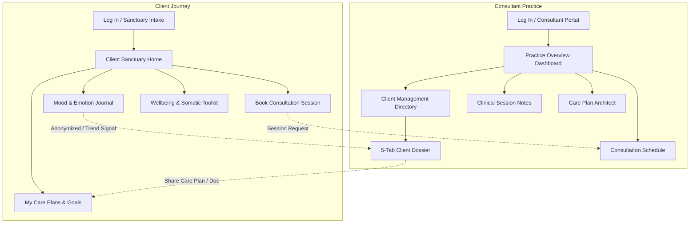

# Design System & UI/UX Specifications

This document defines the visual language, design system, and trauma-informed user experience principles for **Project 412**. All UI development and feature additions must align with these specifications to ensure a cohesive, accessible, and therapeutic environment.

---

## 1. Trauma-Informed Design Philosophy

Unlike typical productivity or clinical software, this platform is built with a **trauma-informed human-first approach**. Patients and consultants interact with this software during vulnerable moments.

### Core Principles
1. **Safety & Predictability**: The UI should never startle the user. Transitions must be gentle, avoiding abrupt popups, flashing banners, or loud audio cues.
2. **Low Cognitive Load**: Clean visual hierarchy, generous white space, and plain language reduce overwhelm for users experiencing heightened anxiety or stress.
3. **Calming Aesthetics**: Warm earth tones, forest greens, muted teals, and soft natural surfaces instead of sterile hospital blues or clinical whites.
4. **Empowerment & Control**: Users should always retain control over their session pacing, breathing exercise speeds, and profile privacy. Destructive actions must always offer confirmation.

---

## 2. Color Palette & Theming

The application features a fully responsive dual-palette system with seamless light and dark mode toggling.

### 2.1 Primary & Accent Palette

| Token / Role | Hex Code | Tailwind Utility | Visual Application |
| :--- | :--- | :--- | :--- |
| **Forest Teal (Primary)** | `#14302c` / `#004d40` | `text-teal-900`, `bg-teal-700` | Brand identity, primary CTAs, active tab indicators |
| **Emerald Accent** | `#059669` / `#10b981` | `text-emerald-600`, `bg-emerald-500` | Completed goals, confirmed sessions, positive milestones |
| **Soothing Sage (Light)** | `#f0fdf4` / `#e6f4f1` | `bg-[#f4f7f6]` | Light mode background, card fills, calming accents |
| **Deep Forest (Dark)** | `#0a1716` / `#112322` | `dark:bg-[#0a1716]` | Dark mode canvas, high-contrast dark card containers |
| **Warm Sand / Amber** | `#f59e0b` / `#d97706` | `text-amber-600`, `bg-amber-100` | Pending sessions, cautionary alerts, attention states |
| **Soft Terracotta (Danger)**| `#dc2626` / `#ef4444` | `text-rose-600`, `bg-rose-50` | Destructive actions (cancel session, delete note), crisis SOS |

### 2.2 Mood Scale Colors
Mood ratings (1–5) are visually codified for instant emotional recognition:

| Level | Value | Label | Visual Color & Tailwind Class |
| :--- | :--- | :--- | :--- |
| 1 | 😢 Very Low | Struggling | `bg-rose-500` / Rose |
| 2 | 🙁 Low | Overwhelmed | `bg-amber-500` / Amber |
| 3 | 😐 Neutral | Steady | `bg-blue-400` / Sky Blue |
| 4 | 🙂 Good | Positive | `bg-emerald-400` / Soft Mint |
| 5 | 😄 Thriving | Energized | `bg-teal-500` / Vibrant Teal |

---

## 3. Typography System

The application pairs an editorial therapeutic serif for emotional warmth with an accessible modern sans-serif for UI legibility.

### 3.1 Font Families
* **Display / Headings**: `'Playfair Display', serif`
  * *Usage*: View titles (`Sanctuary Overview`, `Practice Management`), modal headers, welcoming banners.
  * *Characteristics*: High elegance, warm, therapeutic, grounding.
* **Interface / Body**: `'Plus Jakarta Sans', system-ui, sans-serif`
  * *Usage*: Body copy, navigation links, data tables, form inputs, button labels.
  * *Characteristics*: High x-height, maximum legibility across mobile and desktop.
* **Iconography**: Google Material Symbols Outlined (`material-symbols-outlined`)
  * *Style*: 20px–24px standard, optical size 24, font-weight 400.

### 3.2 Type Scale
* **Display**: `text-2xl sm:text-3xl font-serif font-bold text-[#14302c] dark:text-[#e3efec]`
* **Section Heading**: `text-lg sm:text-xl font-bold font-serif`
* **Card Title**: `text-base font-bold text-[#14302c] dark:text-[#e3efec]`
* **Body / Label**: `text-sm font-medium text-[#2d4d47] dark:text-[#c4dbd6]`
* **Muted Caption**: `text-xs text-[#5f7571] dark:text-[#8fa8a3]`

---

## 4. Component Design Patterns

To maintain visual cohesion, reusable design tokens are defined in `src/data/constants.js`:

```javascript
// Reusable classes
clsInput = "w-full px-3.5 py-2.5 rounded-xl border border-[#c3d4cf] dark:border-[#2f4d4a] bg-white dark:bg-[#122524] text-sm text-[#14302c] dark:text-[#e3efec] focus:outline-none focus:ring-2 focus:ring-teal-600/30 dark:focus:ring-teal-400/30 transition-all";
clsCard = "bg-white dark:bg-[#112322] border border-[#dde7e3] dark:border-[#203a38] rounded-2xl p-5 shadow-sm transition-all";
clsBtnPrimary = "inline-flex items-center justify-center gap-2 px-4 py-2 rounded-xl text-sm font-semibold bg-teal-700 hover:bg-teal-800 text-white shadow-sm transition-colors";
clsBtnSecondary = "inline-flex items-center justify-center gap-2 px-3.5 py-2 rounded-xl text-sm font-medium border border-[#c3d4cf] dark:border-[#2f4d4a] hover:bg-[#eef5f3] dark:hover:bg-[#1a3533] text-[#14302c] dark:text-[#e3efec] transition-colors";
clsBtnDanger = "inline-flex items-center justify-center gap-1.5 px-3 py-1.5 rounded-lg text-xs font-semibold bg-rose-50 dark:bg-rose-950/40 text-rose-700 dark:text-rose-300 hover:bg-rose-100 dark:hover:bg-rose-900/60 transition-colors";
```

### 4.1 Key Component Specifications
* **`StatCard`**: High-level telemetry card showcasing a numeric KPI, icon with tinted background badge, and trend context.
* **`Chip`**: Semantic status indicator (`Confirmed`, `Pending`, `Completed`, `Active`) with accessible contrast colors.
* **`EmptyState`**: Non-intimidating placeholder displaying an outlined icon, reassuring title, supportive description, and a clear call-to-action button.
* **`Toast`**: Bottom-right floating notifications with automatic 3.5s dismissal and smooth fade-in slide-up transitions.
* **`ClientDossierModal`**: 5-tab deep clinical management view (Overview, Appointments, Care Plans, Session Notes, Shared Documents).

---

## 5. System Architecture & Interaction Flow



---

## 6. Accessibility & Safety (WCAG 2.1 AA)

All new views and components must comply with accessibility and safety requirements:
1. **Contrast Ratio**: Minimum `4.5:1` contrast for body copy against all light and dark background variations.
2. **Accessible Form Fields**: Explicit `<label>` associations for every input, with clear visual error states.
3. **Motion Sensitivity**: Respect `prefers-reduced-motion` settings. Breathing toolkit cycles must support manual pause and reset.
4. **Crisis Accessibility**: Emergency helpline and grounding resources must remain accessible within 1 click from any client sanctuary view.
